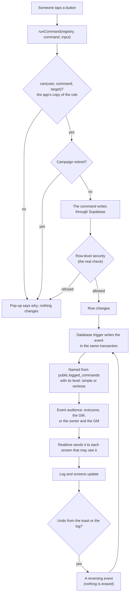

# Command flow

How every change reaches the database and the log (hard rules: everything through commands, everything logged, hidden means hidden). Spec: `docs/02-architecture.md`; the command list: `docs/generated/commands.md`.

Tests on the same path: `npm test` checks `can()` against every permission case; `npm run test:db` runs the same cases against the test project and checks the events written.
