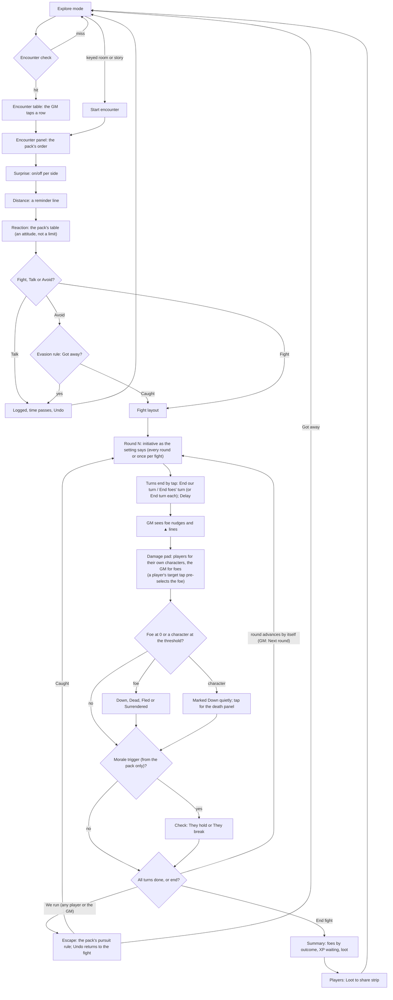

# Fight flow

From exploring to an encounter, a fight and back (M6, ruled 2026-10-26; revised after the fight dry run, 2026-10-29). Spec: `docs/05-features.md`, "Explore, Encounter and Fight" and "Combat tracker (GM)"; screens: `docs/06-screens-and-design.md`, "Fight layouts". The app never rolls or decides an outcome: dice stay at the table.

Hidden means hidden throughout: foe HP, morale scores, GM-only foe notes and GM-only results never reach players' devices. The one exception: a Down or dead character's pack and purse open to the other players.
